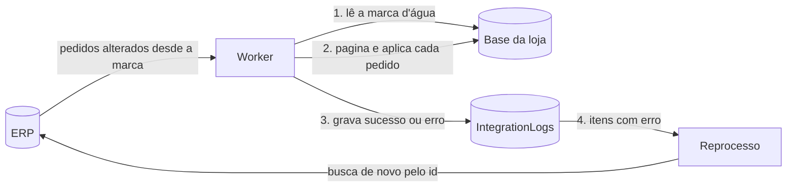

# incremental-sync-worker


Worker em **.NET 8** que sincroniza pedidos de um ERP com a base de uma loja virtual, de forma **incremental**, **idempotente** e **tolerante a falhas**.

É um projeto de estudo com um cenário fictício (uma livraria), construído para mostrar os padrões que uso no dia a dia com integrações entre sistemas corporativos.

## O problema

O ERP é a fonte dos pedidos; a loja precisa de uma cópia atualizada. Ler tudo a cada ciclo não escala, e uma integração real precisa lidar com:

- registros que o ERP grava **com atraso** (a transação confirma depois da leitura);
- a mesma alteração chegando **mais de uma vez**;
- dados que **não batem** com a loja (um status novo sem correspondência);
- o ERP **fora do ar** ou respondendo com erro;
- um item com problema **não pode travar** a fila inteira.

## Como funciona



A cada ciclo (`SyncBackgroundService`):

1. **Leitura incremental por marca d'água** (`OrderSyncService`): busca só os pedidos alterados desde a última leitura, página por página, ordenados por data de alteração.
2. **Margem de segurança**: a janela começa alguns minutos **antes** da marca d'água (`OverlapMinutes`) para não perder registros gravados com atraso.
3. **Idempotência** (`OrderUpserter`): se a loja já tem aquela versão do pedido (ou uma mais nova), nada é regravado, e o log de sucesso **não é reescrito**, preservando a data original da integração.
4. **De-para em tabela** (`StatusMappings`): o status do ERP é traduzido para o da loja. Um status sem de-para vira erro de integração, não exceção.
5. **Log por item** (`IntegrationLogs`): uma linha por pedido com o último resultado, o número de tentativas e a mensagem de erro.
6. **Reprocesso** (`ReprocessService`): os itens com erro são buscados de novo no ERP pelo id e reaplicados com a mesma regra. Depois de `MaxReprocessAttempts` tentativas, saem da fila como `GaveUp`.
7. **Resiliência HTTP**: retry com backoff exponencial, timeout por tentativa e circuit breaker via `Microsoft.Extensions.Http.Resilience` (Polly).

### Por que a marca d'água avança mesmo quando um item falha?

Se ela parasse no item com erro, um único pedido problemático travaria a integração inteira, e todos os pedidos seguintes seriam relidos a cada ciclo. Aqui o item com erro fica registrado no log e é reprocessado **pelo id**, de forma independente.

## Stack

- .NET 8 Worker Service, `BackgroundService` + `PeriodicTimer`
- Entity Framework Core 8 com **SQL Server** (Docker) ou **SQLite** (local, sem instalar nada)
- `IHttpClientFactory` + `AddStandardResilienceHandler` (Polly)
- xUnit, com SQLite em memória
- Docker Compose e GitHub Actions

## Estrutura

```
src/
  SyncWorker/          # o worker
    Data/              # entidades, DbContext e de-para inicial
    Erp/               # cliente HTTP do ERP
    Sync/              # leitura incremental, upsert idempotente e reprocesso
  FakeErp.Api/         # ERP fictício: pagina, altera pedidos e falha de propósito
tests/
  SyncWorker.Tests/    # testes dos cenários acima
```

## Rodando

### Com Docker (SQL Server + ERP fictício + worker)

```bash
docker compose up --build
```

### Local, com SQLite

```bash
# terminal 1: ERP fictício em http://localhost:5080
dotnet run --project src/FakeErp.Api

# terminal 2: worker gravando em sync.db
dotnet run --project src/SyncWorker
```

O ERP fictício altera 3 pedidos a cada 10 segundos, responde **503 em ~10% das chamadas** (para o retry trabalhar) e, de vez em quando, envia o status `EM_ANALISE`, que não tem de-para. Esses pedidos aparecem como erro em `IntegrationLogs`. Para ver o reprocesso recuperar, cadastre o de-para:

```sql
INSERT INTO StatusMappings (ErpStatus, StoreStatus, Active) VALUES ('EM_ANALISE', 'UnderReview', 1);
```

### Testes

```bash
dotnet test
```

Cenários cobertos: carga inicial paginada, reexecução sem duplicar nem reescrever log, atualização de versão mais nova, registro gravado com atraso dentro da margem, status sem de-para, total negativo, recuperação após cadastrar o de-para, desistência após o limite de tentativas e pedido removido do ERP.

## Configuração (`appsettings.json`)

| Chave | Padrão | O que faz |
| --- | --- | --- |
| `Sync:IntervalSeconds` | 30 | Intervalo entre ciclos |
| `Sync:PageSize` | 50 | Pedidos por página |
| `Sync:OverlapMinutes` | 5 | Margem antes da marca d'água |
| `Sync:MaxReprocessAttempts` | 5 | Tentativas antes de desistir |
| `Sync:ReprocessBatchSize` | 20 | Itens reprocessados por ciclo |
| `Database:Provider` | Sqlite | `Sqlite` ou `SqlServer` |

## Próximos passos

- Migrations do EF Core no lugar do `EnsureCreated`
- Endpoint de saúde e métricas (OpenTelemetry)
- Notificação quando um item chega a `GaveUp`
